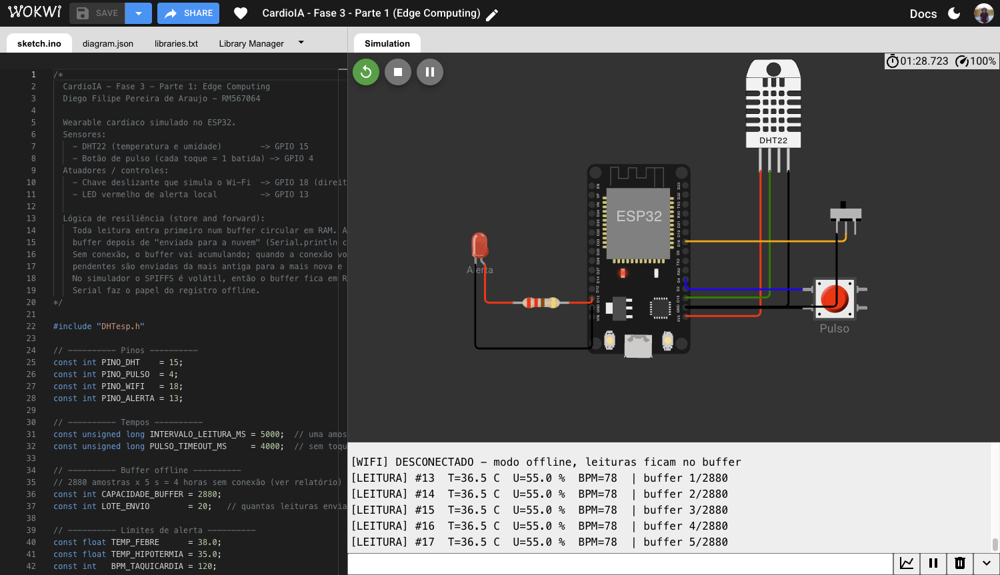
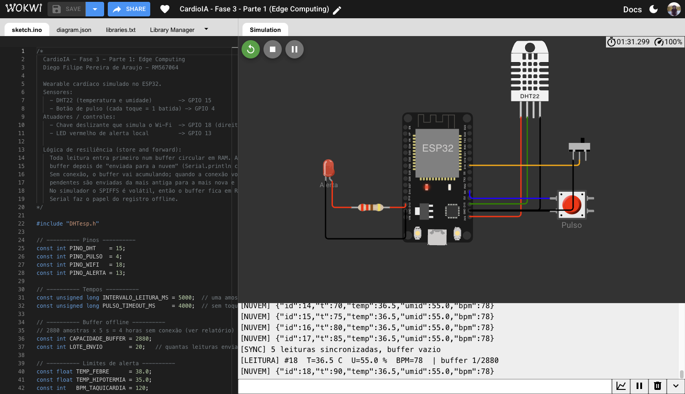
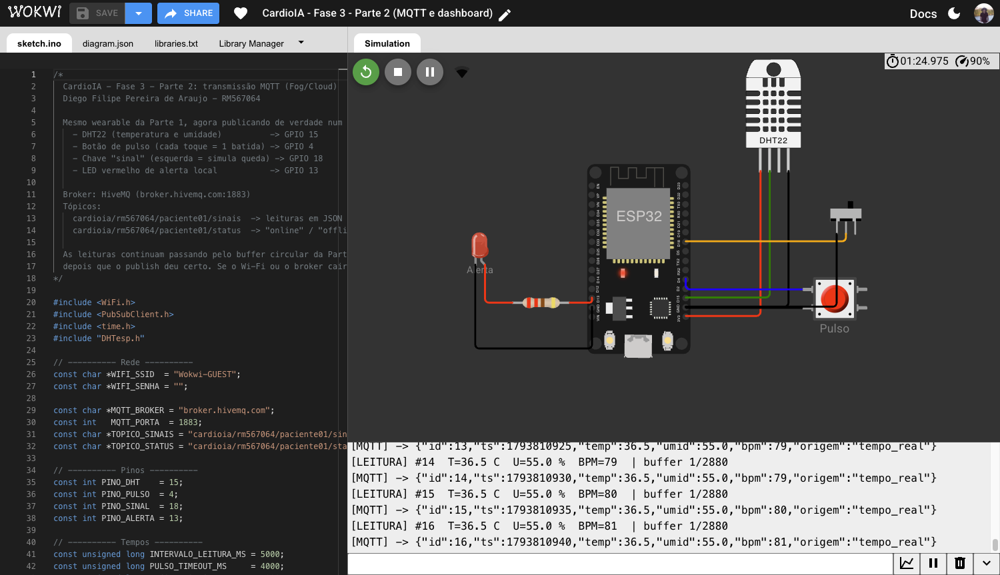
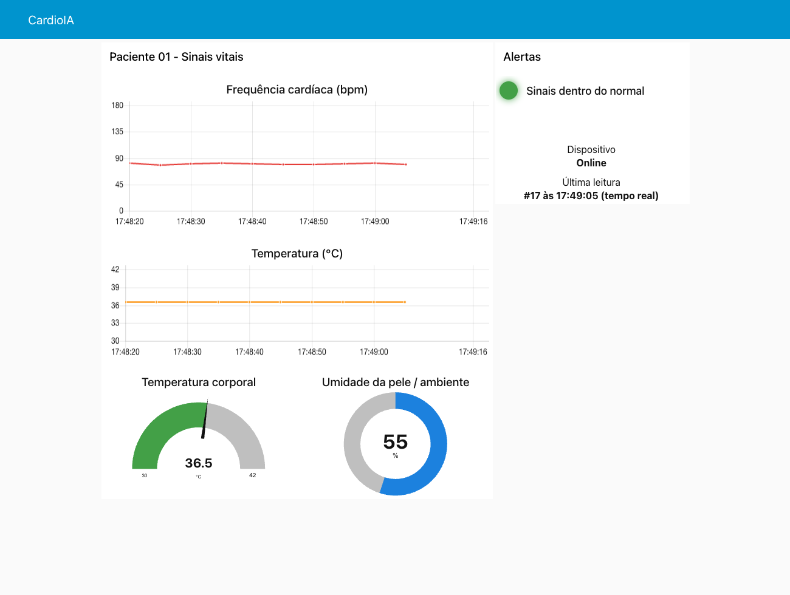
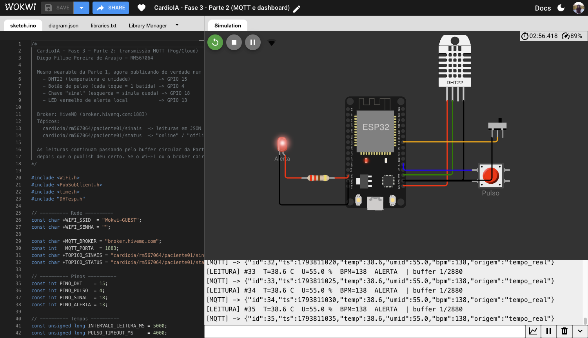
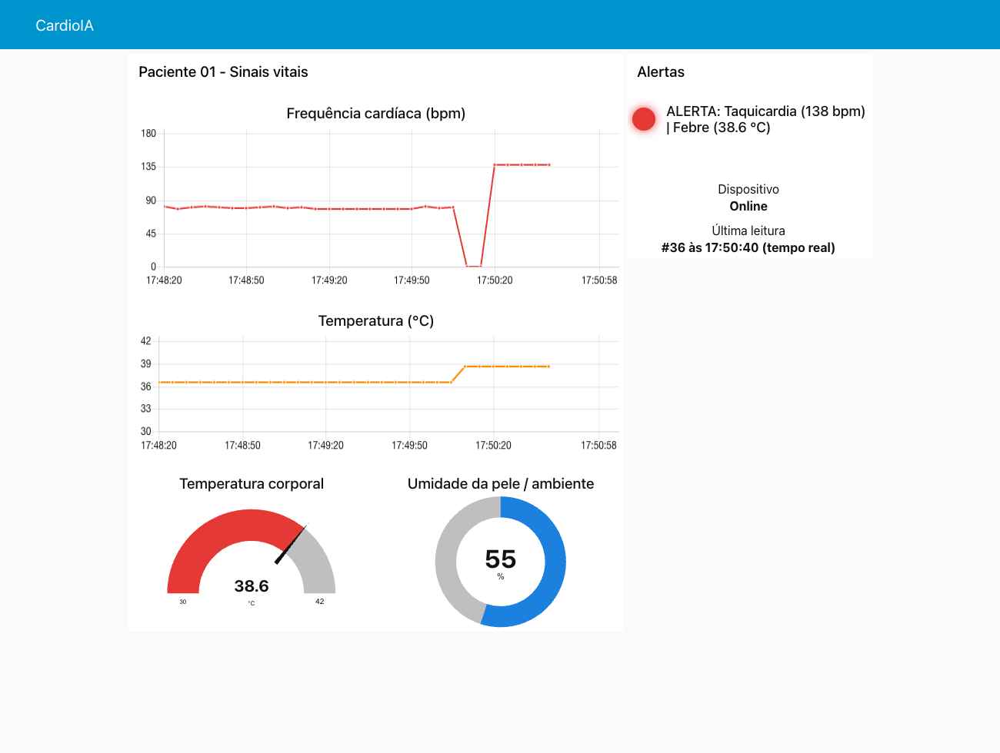
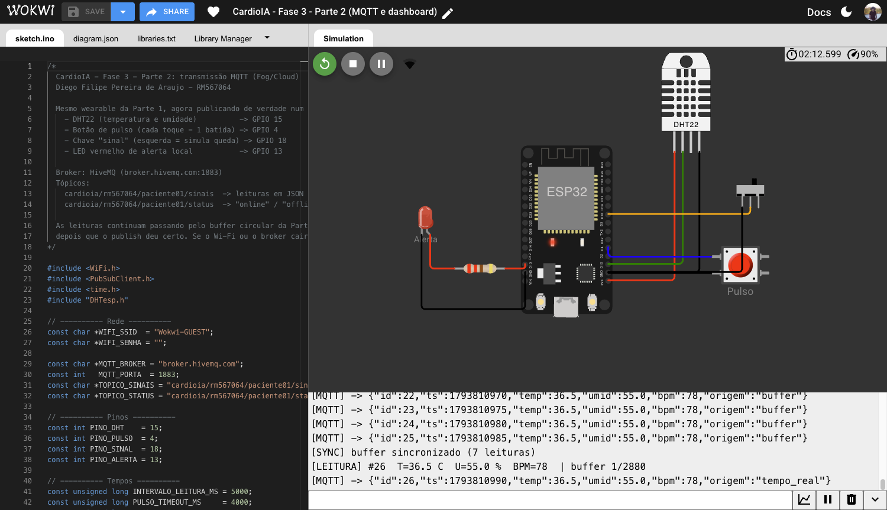
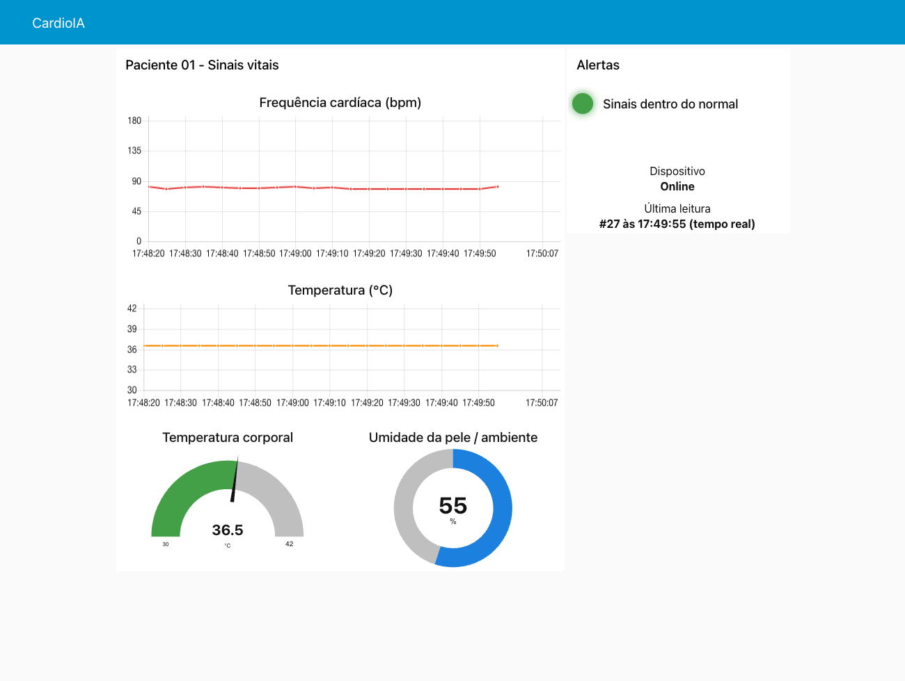

# CardioIA — Fase 3: Monitoramento Contínuo — IoT no Peito do Paciente

**Aluno:** Diego Filipe Pereira de Araujo — RM567064
**Curso:** Bacharelado em Inteligência Artificial — FIAP ON (2º ano)
**Entrega:** Fase 3 — wearable com ESP32, Edge Computing, MQTT e dashboard no Node-RED

**Projetos no Wokwi:**
- Parte 1 (Edge): https://wokwi.com/projects/479777108727922689
- Parte 2 (MQTT): https://wokwi.com/projects/479777077436303361

---

## Sobre esta entrega

As duas primeiras fases trabalharam com dados parados: a Fase 1 montou as bases (dados clínicos, textos e ECGs) e a Fase 2 aprendeu a ler o que o paciente **diz** — extraindo sintomas de relatos e classificando o risco de uma frase.

Só que um relato acontece uma vez, na consulta. Entre uma consulta e outra o paciente vai para casa e o hospital fica sem saber nada. Esta fase preenche esse intervalo com o que o paciente **mede**: um wearable que acompanha temperatura e frequência cardíaca o tempo todo, continua funcionando sem internet e avisa a equipe quando algo sai do normal.

| Fase | Fonte da informação | Quando |
|---|---|---|
| 1 | bases clínicas históricas | antes |
| 2 | relato do paciente | na consulta |
| **3** | **sinais vitais do wearable** | **continuamente, em casa** |

A frequência cardíaca, que na Fase 1 aparecia como uma coluna estática do dataset UCI (`thalach`, frequência máxima no teste de esforço) e já tinha sido apontada como variável coletável por sensores vestíveis, aqui vira uma série temporal ao vivo. Esse é o tipo de dado que as fases seguintes do projeto vão usar para prever crises.

| Parte | Pergunta que responde | Camada |
|---|---|---|
| **1 — Armazenamento e processamento local** | *O que o dispositivo faz quando está sozinho?* | Edge |
| **2 — Transmissão e visualização** | *Como a equipe acompanha o paciente à distância?* | Fog / Cloud |

---

## Estrutura

```
Fase_03/
├── README.md                     este documento
├── atividade.md                  enunciado da fase
├── mapa_mental.png               mapa mental do PBL
├── links.txt                     links de entrega
├── parte1_edge/
│   ├── sketch.ino                firmware: sensores, buffer circular, alerta local
│   ├── diagram.json              circuito do Wokwi
│   ├── libraries.txt             bibliotecas do Wokwi
│   ├── prints/                   evidências da simulação no Wokwi
│   └── RELATORIO.md              fluxo de funcionamento e lógica de resiliência
└── parte2_mqtt/
    ├── sketch.ino                firmware: Wi-Fi, NTP, MQTT e sincronização do buffer
    ├── diagram.json              circuito do Wokwi
    ├── libraries.txt             bibliotecas do Wokwi
    ├── node-red/flows.json       export do fluxo e do dashboard
    ├── prints/                   evidências do Wokwi e do dashboard
    └── RELATORIO.md              fluxo MQTT e configuração do dashboard
```

## O circuito

O mesmo circuito é usado nas duas partes:

| Componente | Pino | Papel |
|---|---|---|
| DHT22 | GPIO 15 | temperatura e umidade |
| Botão "Pulso" (tecla **P**) | GPIO 4 | cada toque é uma batida; o bpm vem do intervalo entre toques |
| Chave deslizante | GPIO 18 | direita = conectado, esquerda = sem sinal |
| LED vermelho + 220 Ω | GPIO 13 | alerta local |

## Como reproduzir

**Wokwi.** Abrir os links acima e clicar em ▶. Para montar do zero, basta criar um projeto ESP32 e copiar os três arquivos da pasta da parte desejada (`sketch.ino`, `diagram.json`, `libraries.txt`). O pulso é batido clicando no botão vermelho ou segurando o ritmo na tecla **P**; a temperatura muda clicando no DHT22.

**Node-RED** (Parte 2):

```bash
npm install -g --unsafe-perm node-red
node-red
```

Em `http://localhost:1880`: *Manage palette* → instalar `node-red-dashboard` → *Import* de `parte2_mqtt/node-red/flows.json` → *Deploy*. Com a simulação da Parte 2 rodando no Wokwi, o painel aparece em `http://localhost:1880/ui`.

---

## Parte 1 — Edge Computing

Relatório completo: [`parte1_edge/RELATORIO.md`](parte1_edge/RELATORIO.md)

Toda leitura entra primeiro num **buffer circular em RAM** e só sai dele depois de enviada. Com a chave na posição "conectado", o envio é imediato (`Serial.println` com prefixo `[NUVEM]`); sem conexão, a coleta segue igual e o buffer acumula. Quando a conexão volta, as pendentes são enviadas da mais antiga para a mais nova e apagadas.

| Decisão | Valor | Motivo |
|---|---|---|
| Intervalo de coleta | 5 s | 720 amostras por hora, suficiente para acompanhar tendência de bpm e temperatura |
| Capacidade do buffer | **2880 amostras** | 4 horas offline, cobrindo saídas de casa e quedas de roteador; ocupa ~56 KB de RAM |
| Buffer cheio | descarta a mais antiga | o dado recente é o que importa para agir |
| Envio | lotes de 20 por volta do loop | a sincronização não trava a leitura do pulso |

O alerta (LED) é calculado no próprio ESP32, antes de qualquer envio. Febre durante uma queda de Wi-Fi acende o LED do mesmo jeito.

| | |
|---|---|
|  |  |
| *Sem conexão, as leituras se acumulam no buffer* | *Conexão de volta: as pendentes saem em ordem e o buffer esvazia* |

## Parte 2 — MQTT e dashboard

Relatório completo: [`parte2_mqtt/RELATORIO.md`](parte2_mqtt/RELATORIO.md)

O ESP32 se conecta ao Wi-Fi do Wokwi, sincroniza o relógio por NTP e publica cada leitura em JSON no broker HiveMQ:

```
cardioia/rm567064/paciente01/sinais   {"id":42,"ts":1793628120,"temp":36.7,"umid":54.0,"bpm":82,"origem":"tempo_real"}
cardioia/rm567064/paciente01/status   online | offline   (retido, com Last Will)
```

O buffer da Parte 1 continua no caminho: se o broker cair, as leituras esperam e são publicadas depois com `"origem":"buffer"` e o horário original da coleta, então o gráfico preenche o período offline nos horários certos.

O dashboard no Node-RED tem:

- **gráfico** de frequência cardíaca e **gráfico** de temperatura (janela de 30 min);
- **gauge** de temperatura corporal com faixas coloridas nos mesmos limites dos alertas, e gauge de umidade;
- **LED virtual** verde / amarelo / vermelho com o texto do alerta;
- estado do dispositivo (online/offline) e origem da última leitura.

| Alerta | Condição |
|---|---|
| Taquicardia | bpm > 120 |
| Bradicardia | 0 < bpm < 50 |
| Febre | temperatura ≥ 38,0 °C |
| Temperatura baixa | temperatura < 35,0 °C |
| Sem leitura de pulso (aviso) | bpm = 0 |

### Evidências

| | |
|---|---|
|  |  |
| *ESP32 publicando no HiveMQ a cada 5 s* | *Painel com sinais normais* |
|  |  |
| *38,6 °C e 138 bpm: LED do circuito aceso* | *Painel em alerta: taquicardia e febre* |
|  |  |
| *Leituras da queda publicadas com `origem: buffer`* | *Período offline preenchido no gráfico* |

---

## Limites desta versão

- O buffer fica em RAM porque o SPIFFS é volátil no simulador. Num ESP32 real ele iria para um arquivo no LittleFS e sobreviveria a um reset.
- O broker público não tem autenticação nem criptografia. Serve para demonstrar o fluxo, não para dado de saúde real — o relatório da Parte 2 descreve o que mudaria (TLS, credenciais por dispositivo, ACL por tópico).
- O PubSubClient só publica com QoS 0; uma leitura enviada no instante exato de uma queda pode se perder. O `id` sequencial permite detectar essa lacuna.
- O "batimento" é um botão. Ele exercita toda a cadeia — cálculo de bpm, limites, alerta, transmissão —, mas não tem o ruído de um sensor óptico real.
