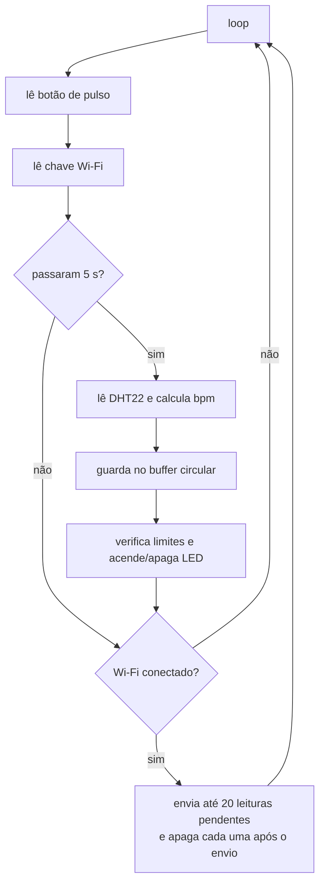
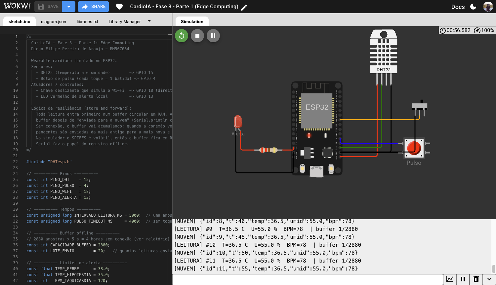
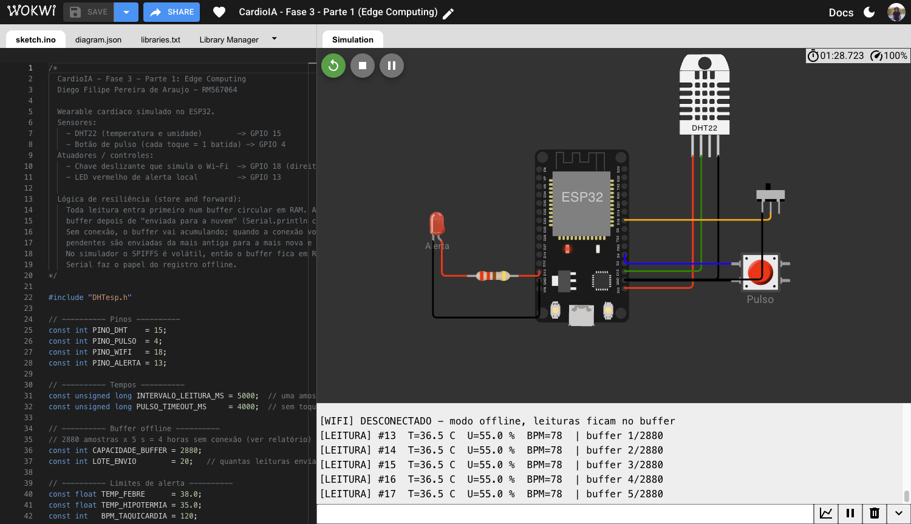
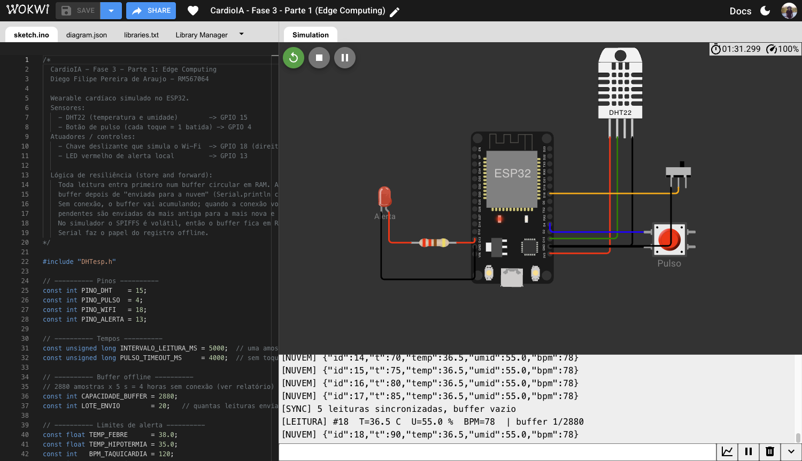
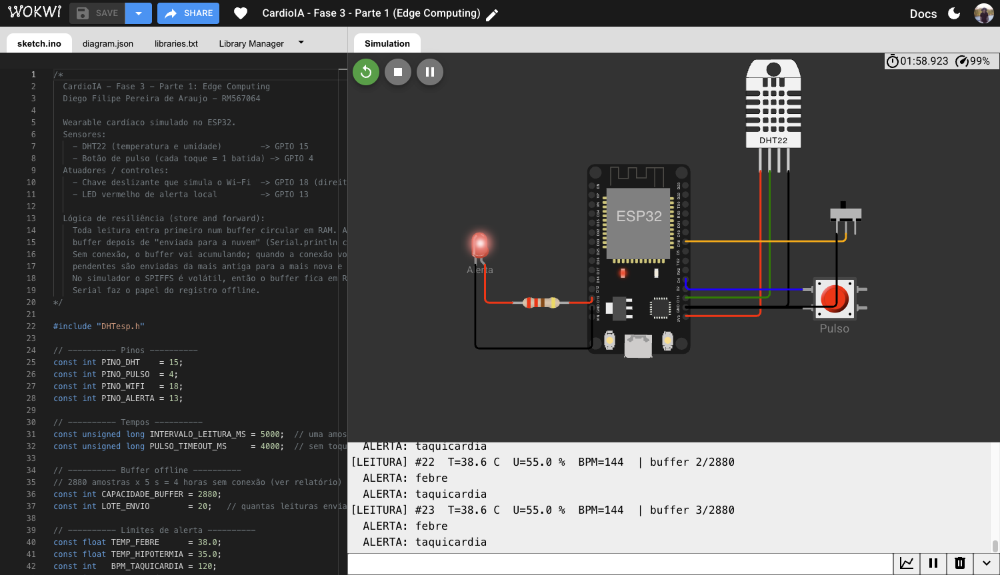

# Parte 1 — Armazenamento e processamento local (Edge Computing)

**Aluno:** Diego Filipe Pereira de Araujo — RM567064
**Projeto no Wokwi:** https://wokwi.com/projects/479777108727922689
**Arquivos:** [`sketch.ino`](sketch.ino) · [`diagram.json`](diagram.json) · [`libraries.txt`](libraries.txt)

---

## 1. O que foi montado

O protótipo simula um wearable cardíaco preso ao peito do paciente. O ESP32 lê dois sensores, decide sozinho se há algo errado e guarda as leituras até ter conexão para enviá-las.

| Componente | Pino | Função |
|---|---|---|
| DHT22 | GPIO 15 | temperatura e umidade (sensor 1) |
| Botão "Pulso" | GPIO 4 | cada toque é uma batida do coração (sensor 2) |
| Chave deslizante | GPIO 18 | alimenta a variável booleana `wifiConectado`: direita = conectado, esquerda = sem sinal |
| LED vermelho + resistor 220 Ω | GPIO 13 | alerta local no próprio dispositivo |

O botão e a chave usam o `INPUT_PULLUP` interno, então não precisam de resistor externo. No Wokwi o botão também responde à tecla **P**, o que facilita bater num ritmo constante.

### Como o batimento é medido

O botão não conta "quantas vezes foi apertado em um minuto". Esperar 60 segundos para ter um valor deixaria o monitor lento demais. O firmware mede o **intervalo entre dois toques** e converte para bpm (`60000 / intervalo_ms`), usando a média dos últimos 4 intervalos para suavizar a variação natural da mão.

Dois filtros evitam leituras absurdas:

- intervalos menores que 250 ms (> 240 bpm) ou maiores que 2 s (< 30 bpm) são descartados como ruído;
- se passar 4 s sem nenhum toque, o bpm vira **0**, que significa "sem pulso detectado" — e não "coração parado". Num dispositivo real isso indicaria sensor solto.

O debounce é feito em software (30 ms), além de o botão estar configurado sem bouncing no diagrama.

## 2. Fluxo de funcionamento



O `loop()` nunca usa `delay()`. Todos os tempos são controlados por `millis()`, por isso o botão continua sendo lido enquanto o resto acontece — um `delay(5000)` faria o dispositivo perder os toques do pulso.

A cada 5 segundos uma amostra com `id`, tempo desde que ligou, temperatura, umidade e bpm é criada. **Toda amostra entra primeiro no buffer**, esteja o Wi-Fi ligado ou não. O envio é uma etapa separada que só consome o que já está guardado. Esse padrão se chama *store and forward*: com ele não existe um caminho "online" e outro "offline" no código, existe um caminho só, e a conexão decide apenas quando o buffer é esvaziado.

O envio para a nuvem é simulado com `Serial.println`, no formato JSON que a Parte 2 vai publicar via MQTT:

```
[NUVEM] {"id":12,"t":60,"temp":36.5,"umid":55.0,"bpm":78}
```

## 3. Lógica de resiliência offline

### Estrutura

As leituras ficam num **buffer circular** (`Leitura buffer[2880]`) controlado por dois índices: `inicio`, a leitura mais antiga, e `quantidade`, quantas estão esperando envio. Inserir e remover custa O(1) e não há realocação de memória, o que importa num microcontrolador que precisa rodar dias sem reiniciar.

| Situação | O que acontece |
|---|---|
| Wi-Fi conectado | cada nova leitura é enviada logo em seguida; o buffer fica com 0 ou 1 item |
| Wi-Fi caiu | a coleta continua normalmente e o buffer vai enchendo (`buffer 37/2880` no serial) |
| Wi-Fi voltou | as pendentes são enviadas **da mais antiga para a mais nova**, em lotes de 20 por volta do loop, e cada uma é apagada depois de enviada |
| Buffer cheio | a leitura mais antiga é sobrescrita e um contador de descartes avisa quantas se perderam quando a conexão volta |

Enviar em lotes de 20, e não tudo de uma vez, evita que uma sincronização de milhares de amostras trave a leitura do sensor de pulso.

### Por que 2880 amostras

A capacidade foi escolhida pelo uso esperado do produto: um paciente cardíaco em acompanhamento domiciliar, com o wearable conectado ao Wi-Fi de casa ou ao celular. As quedas de conexão previstas são as do dia a dia — ir ao mercado, uma consulta, uma ida ao banho com o celular em outro cômodo, o roteador reiniciando.

- uma amostra a cada **5 s** = 720 amostras por hora;
- **4 horas** de autonomia offline cobrem com folga essas situações;
- 720 × 4 = **2880 amostras**;
- cada `Leitura` ocupa 20 bytes, então o buffer usa cerca de **56 KB** dos ~320 KB de RAM do ESP32, deixando espaço para a pilha Wi-Fi/MQTT da Parte 2.

Quando o buffer enche, a decisão foi **descartar a mais antiga**. Para monitoramento cardíaco, o que aconteceu nos últimos minutos é mais útil para quem vai agir do que o registro de quatro horas atrás. A alternativa — parar de gravar quando enche — preservaria o passado e perderia justamente o momento em que o paciente pode estar passando mal.

### O alerta não depende da internet

A verificação de limites roda no próprio ESP32, a cada amostra, antes de qualquer envio. Se o paciente estiver com febre durante uma queda de conexão, o LED acende na hora. Esse é o ponto central do Edge Computing numa aplicação de saúde: a decisão crítica não pode esperar a nuvem responder.

| Condição | Limite |
|---|---|
| Taquicardia | bpm > 120 |
| Bradicardia | 0 < bpm < 50 |
| Febre | temperatura ≥ 38,0 °C |
| Temperatura baixa | temperatura < 35,0 °C |

O limite de taquicardia ficou em 120, e não nos 100 bpm usados para repouso, porque o wearable é usado durante a rotina — subir uma escada já passa de 100 e geraria alarmes falsos o dia inteiro.

## 4. Limitação do simulador

Em um ESP32 real, o buffer seria gravado num arquivo CSV no SPIFFS/LittleFS para sobreviver também a um desligamento da bateria. No Wokwi esse sistema de arquivos é apagado ao fim da simulação, então a solução adotada foi manter o buffer em RAM e usar o Monitor Serial como registro offline, como o próprio enunciado sugere. A lógica de capacidade, ordem de envio e remoção é a mesma; muda só onde os bytes ficam.

Outra simplificação: sem relógio de tempo real, o campo `t` é o tempo desde que o ESP32 ligou. Na Parte 2, com Wi-Fi de verdade, o horário vem de um servidor NTP.

## 5. Como testar no Wokwi

1. Iniciar a simulação com a chave à direita (conectado). O serial mostra `[LEITURA]` seguido de `[NUVEM]` a cada 5 s.
2. Apertar **P** em ritmo constante, cerca de um toque por segundo: o bpm fica perto de 60. Em ritmo rápido passa de 120 e o LED acende.
3. Clicar no DHT22 e subir a temperatura para 38,5 °C: alerta de febre.
4. Mover a chave para a esquerda: aparece `[WIFI] DESCONECTADO` e o contador do buffer sobe a cada leitura, sem nenhuma linha `[NUVEM]`.
5. Depois de algumas leituras, mover a chave para a direita: as leituras pendentes saem em ordem de `id` e o serial termina com `[SYNC] N leituras sincronizadas, buffer vazio`.

## 6. Evidências

Prints do projeto rodando no Wokwi, com o pulso batido no botão em ritmo constante (~78 bpm).

**Coleta com conexão.** Cada `[LEITURA]` é seguida do envio `[NUVEM]`; o buffer nunca passa de 1 item.



**Modo offline.** Com a chave à esquerda, o serial avisa `[WIFI] DESCONECTADO` e o buffer cresce a cada leitura (1/2880, 2/2880 ... 5/2880), sem nenhum envio.



**Sincronização.** Ao voltar a chave, as 5 leituras pendentes (#13 a #17) são enviadas em ordem, com o tempo original de cada uma, e o buffer é esvaziado.



**Alerta sem internet.** Ainda offline, a temperatura do DHT22 foi para 38,6 °C e o pulso para ~144 bpm: o LED acende e o serial registra febre e taquicardia, enquanto as leituras continuam indo para o buffer.


