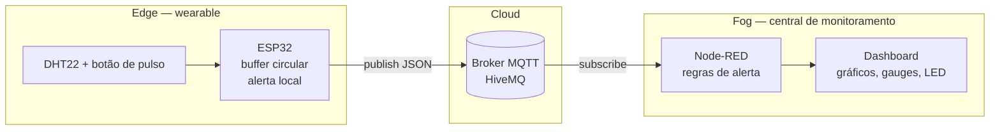
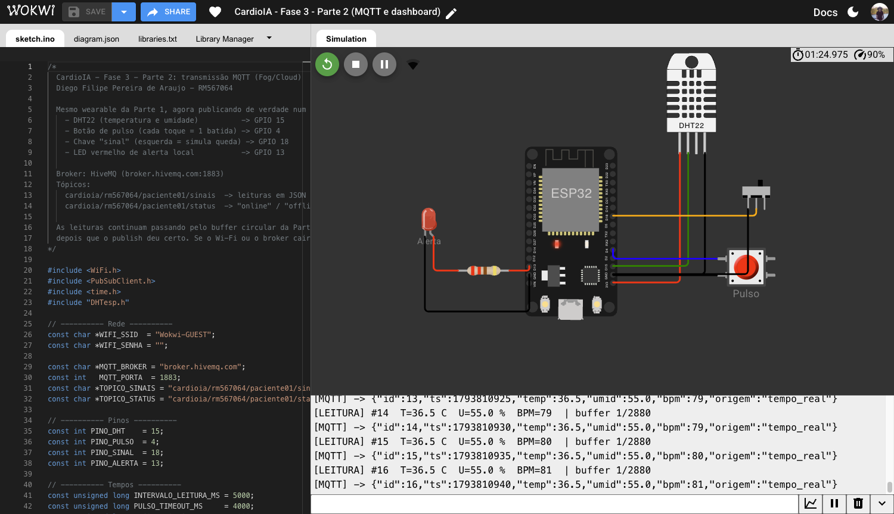
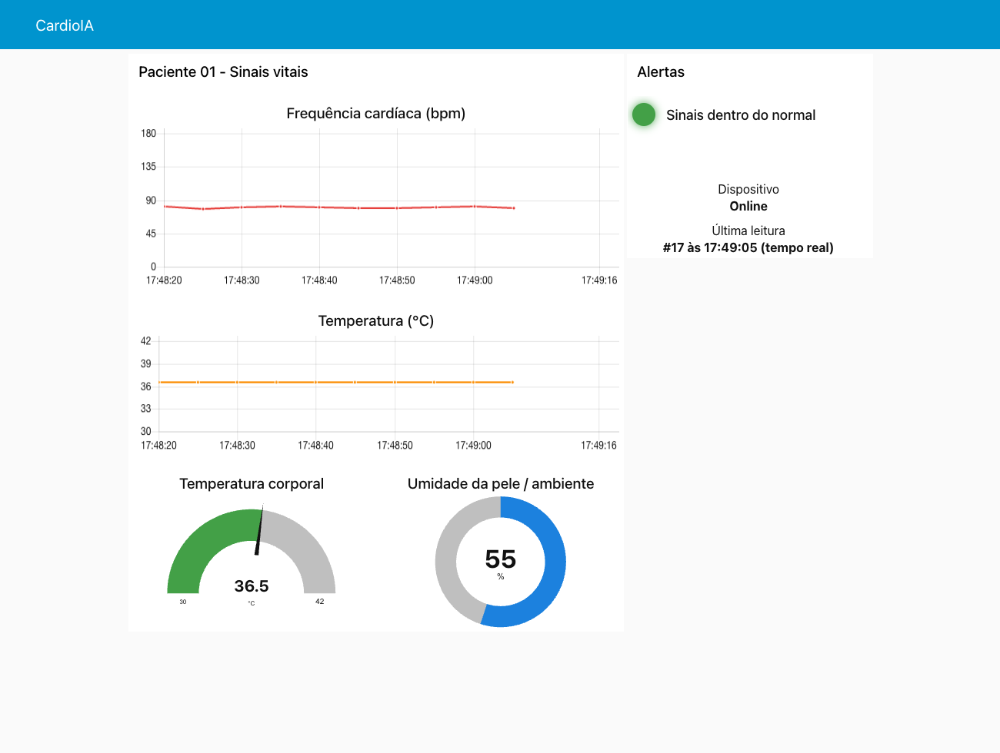
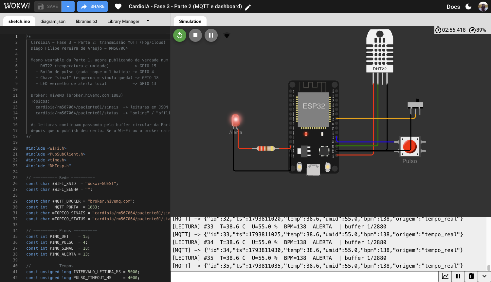
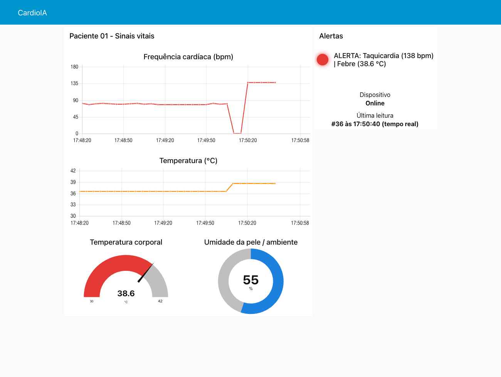
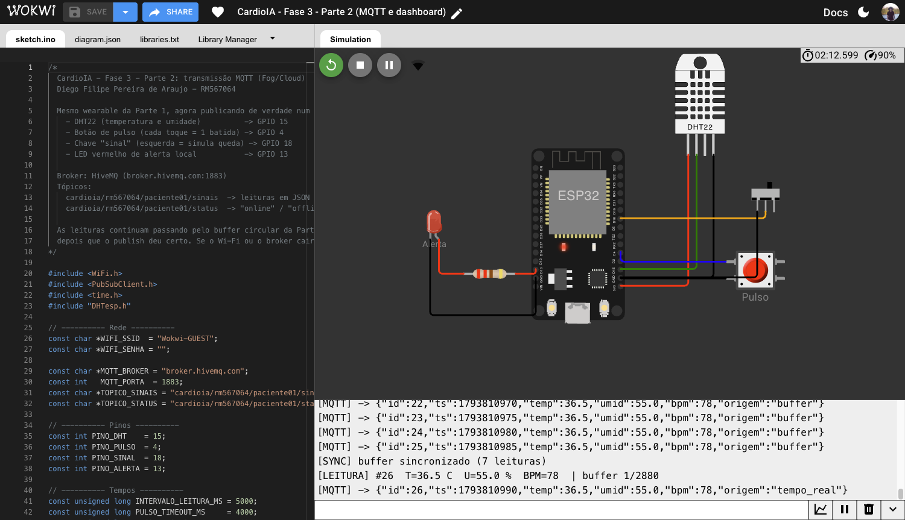
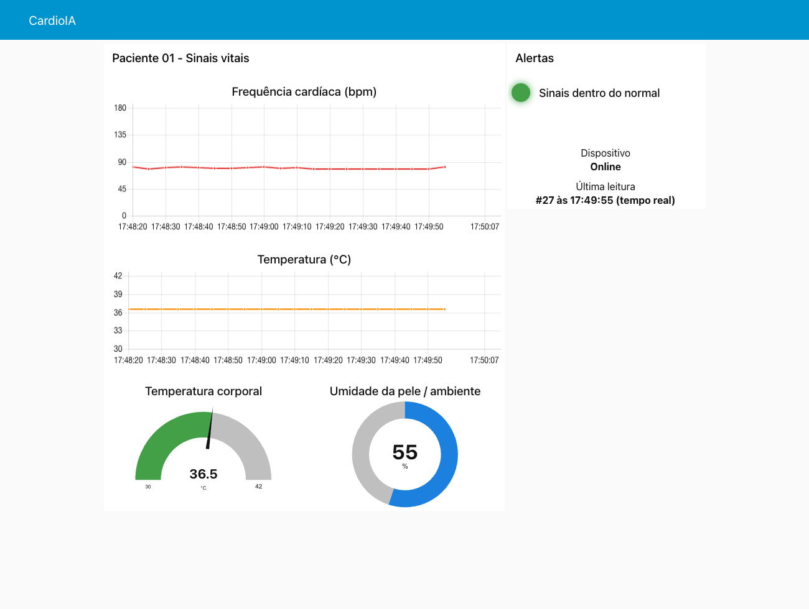

# Parte 2 — Transmissão para nuvem e visualização (Fog/Cloud Computing)

**Aluno:** Diego Filipe Pereira de Araujo — RM567064
**Projeto no Wokwi:** https://wokwi.com/projects/479777077436303361
**Arquivos:** [`sketch.ino`](sketch.ino) · [`diagram.json`](diagram.json) · [`libraries.txt`](libraries.txt) · [`node-red/flows.json`](node-red/flows.json) · [`prints/`](prints/)

---

## 1. Visão geral

A Parte 1 provou que o wearable consegue coletar e guardar dados sozinho. Aqui esses dados saem do dispositivo de verdade: o ESP32 publica cada leitura num broker MQTT na internet, o Node-RED assina o tópico, avalia os valores e monta um painel de monitoramento em tempo real.



Cada camada tem uma responsabilidade:

- **Edge (ESP32):** coleta, alerta imediato pelo LED e retenção dos dados enquanto não há conexão.
- **Cloud (broker):** apenas entrega mensagens. Não interpreta nada, o que permite plugar novos consumidores sem mexer no dispositivo.
- **Fog (Node-RED):** fica próximo da equipe que acompanha o paciente — numa clínica, num servidor local. Aplica as regras de alerta, junta as informações e as apresenta para uma pessoa.

## 2. Por que MQTT

O MQTT foi feito para dispositivos com pouca bateria e conexão instável, que é exatamente o caso de um wearable:

- o cabeçalho mínimo tem 2 bytes, contra centenas de bytes de cabeçalho de uma requisição HTTP;
- a conexão TCP fica aberta, então cada leitura não paga o custo de abrir uma nova conexão;
- o modelo publish/subscribe desacopla quem produz de quem consome. O ESP32 não sabe que o Node-RED existe; amanhã um segundo painel, um banco de dados ou um serviço de e-mail podem assinar o mesmo tópico sem nenhuma mudança no firmware.

## 3. Broker, tópicos e mensagens

### Broker

Foi usado o broker público da HiveMQ (`broker.hivemq.com`, porta 1883). Ele dispensa cadastro e funciona direto do Wokwi, o que torna o projeto reproduzível por qualquer pessoa que abrir o link. A contrapartida está discutida na seção 7: qualquer um que saiba o nome do tópico consegue ler as mensagens.

### Tópicos

| Tópico | Conteúdo | QoS | Retido |
|---|---|:-:|:-:|
| `cardioia/rm567064/paciente01/sinais` | leitura em JSON | 0 | não |
| `cardioia/rm567064/paciente01/status` | `online` / `offline` | 0 (LWT com 1) | sim |

A hierarquia `projeto/identificador/paciente/tipo` permite assinar um paciente específico ou, com curinga, todos de uma vez (`cardioia/rm567064/+/sinais`). O prefixo com o RM evita colisão com outros alunos usando o mesmo broker público.

O paciente é identificado só por `paciente01`. Nome, CPF ou qualquer dado pessoal nunca trafegam no MQTT — a ligação entre o código e a pessoa ficaria no prontuário do hospital, fora deste fluxo.

### Payload

```json
{"id":42,"ts":1793628120,"temp":36.7,"umid":54.0,"bpm":82,"origem":"tempo_real"}
```

| Campo | Significado |
|---|---|
| `id` | número sequencial da amostra; permite perceber falhas ou duplicações |
| `ts` | horário da **coleta** em epoch (via NTP), não o horário do envio |
| `temp`, `umid` | DHT22 |
| `bpm` | frequência cardíaca calculada a partir do botão (0 = sem pulso) |
| `origem` | `tempo_real` ou `buffer` (leitura coletada enquanto o dispositivo estava sem conexão) |

O JSON é montado com `snprintf`, sem biblioteca extra: são seis campos fixos e o tamanho máximo (cerca de 100 bytes) cabe no buffer padrão de 256 bytes do PubSubClient.

### Status com LWT

Ao conectar, o ESP32 registra uma *Last Will and Testament*: se ele sumir sem se despedir (bateria acabou, sinal caiu), o próprio broker publica `offline` no tópico de status quando passa 1,5 vez o keep-alive de 15 s sem notícias dele (cerca de 22 s). Ao conectar com sucesso ele publica `online`. As duas mensagens são **retidas**, então um painel aberto depois já recebe o último estado conhecido, sem esperar a próxima mudança.

## 4. O firmware

O circuito é o mesmo da Parte 1. A chave deslizante, que antes era a variável booleana do Wi-Fi, agora simula uma **perda de sinal real**: ao ser desligada, o ESP32 publica `offline` e derruba a conexão MQTT de fato, e as leituras passam a se acumular no buffer.

Os pontos principais do [`sketch.ino`](sketch.ino):

1. **Conexão não bloqueante.** O `WiFi.begin()` roda uma vez no `setup()` e o próprio ESP32 reconecta o Wi-Fi. A reconexão ao broker é tentada no máximo a cada 5 s dentro do `loop()`. Não há `while (!connected)` travando o código — se houvesse, a coleta pararia justamente quando a rede está ruim.
2. **Horário real via NTP.** `configTime()` sincroniza o relógio logo após o Wi-Fi subir. Isso é o que permite que uma leitura feita às 10h00 e enviada às 10h20 apareça no gráfico às 10h00. Nos primeiros segundos, antes da resposta do servidor NTP, o `ts` vai como `0` e o Node-RED usa o horário de chegada.
3. **Origem marcada na coleta.** Cada leitura guarda se foi feita com ou sem conexão. Assim, tudo o que foi coletado durante a queda chega como `buffer`, inclusive a última leitura antes da volta.
4. **Só apaga o que foi entregue.** `publicarPendentes()` pega a leitura mais antiga do buffer, publica e só a remove se `mqtt.publish()` retornar `true`. Se falhar no meio de um lote, o laço para e as restantes ficam para a próxima tentativa, na mesma ordem.
5. **Sincronização em lotes.** No máximo 20 publicações por volta do loop, intercaladas com a leitura do botão e com `mqtt.loop()`, que mantém o keep-alive.

### Teste de resiliência

| Passo | Serial do ESP32 | Dashboard |
|---|---|---|
| chave ligada | `[MQTT] -> {...,"origem":"tempo_real"}` a cada 5 s | gráficos andando, status *Online* |
| chave desligada | `[SINAL] ... simulando perda de conexao`, buffer subindo | status *Offline*, gráficos param |
| chave ligada de novo | rajada de `[MQTT] -> {...,"origem":"buffer"}` e `[SYNC] buffer sincronizado` | o buraco no gráfico é preenchido com os pontos nos horários corretos |

## 5. Configuração do dashboard no Node-RED

### Instalação

```bash
npm install -g --unsafe-perm node-red
node-red
```

Em `http://localhost:1880`, menu **Manage palette → Install**, instalar `node-red-dashboard`. Depois, **Import** do arquivo [`node-red/flows.json`](node-red/flows.json) e **Deploy**. O painel fica em `http://localhost:1880/ui`.

### O fluxo

```
[mqtt in: sinais] ──> [function: Avaliar leitura] ──┬─> [chart] Frequência cardíaca
        │                                           ├─> [chart] Temperatura
        └─> [debug]                                 ├─> [gauge] Temperatura corporal
                                                    ├─> [gauge] Umidade
                                                    ├─> [template] LED de alerta
                                                    └─> [text] Última leitura

[mqtt in: status] ──> [function: Formatar status] ──> [text] Dispositivo
```

- **mqtt in (sinais):** assina o tópico com saída já em *parsed JSON*, então a função recebe um objeto pronto.
- **Avaliar leitura:** é o centro do fluxo. Valida o formato da mensagem, converte o `ts` em milissegundos e o coloca em `msg.timestamp` — é esse campo que faz o gráfico posicionar a leitura no horário da coleta. Em seguida aplica as regras de alerta e distribui os valores por seis saídas, uma para cada elemento do painel.
- **mqtt in (status):** recebe `online`/`offline`, que a função transforma em texto legível.

### Elementos do painel

| Elemento | Nó | Configuração |
|---|---|---|
| Gráfico de frequência cardíaca | `ui_chart` (linha) | eixo de 0 a 180 bpm, janela de 30 min |
| Gráfico de temperatura | `ui_chart` (linha) | eixo de 30 a 42 °C, janela de 30 min |
| Medidor de temperatura | `ui_gauge` (gage) | 30–42 °C com faixas azul (< 35), verde (35–38) e vermelha (≥ 38) |
| Medidor de umidade | `ui_gauge` (donut) | 0–100 % |
| LED de alerta | `ui_template` | círculo verde, amarelo ou vermelho com a descrição do alerta |
| Dispositivo | `ui_text` | Online / Offline |
| Última leitura | `ui_text` | id, horário e se veio em tempo real ou do buffer |

As cores das faixas do gauge de temperatura usam os mesmos limites dos alertas. Assim, quem olha o painel percebe a febre pela cor antes mesmo de ler o texto.

O LED foi feito com `ui_template` (um `div` redondo cuja cor vem de `msg.cor`) em vez de um nó de terceiros, para que o fluxo funcione só com o `node-red-dashboard` instalado.

### Regras de alerta

| Situação | Condição | LED |
|---|---|---|
| Taquicardia | bpm > 120 | vermelho |
| Bradicardia | 0 < bpm < 50 | vermelho |
| Febre | temperatura ≥ 38,0 °C | vermelho |
| Temperatura baixa | temperatura < 35,0 °C | vermelho |
| Sem leitura de pulso | bpm = 0 | amarelo |
| Normal | nenhuma das anteriores | verde |

Quando mais de uma condição acontece ao mesmo tempo, todas aparecem no texto (`ALERTA: Taquicardia (130 bpm) | Febre (38.4 °C)`). Os limites são os mesmos do firmware. O alerta existe nas duas pontas de propósito: o LED do ESP32 avisa o paciente mesmo sem internet, e o painel avisa a equipe que está longe dele.

O caso *sem pulso* ficou amarelo e não vermelho. Com o sensor real, bpm 0 quase sempre significa sensor mal posicionado; tratar isso como emergência faria a equipe aprender a ignorar o alarme vermelho, que é o pior resultado possível para um sistema de alerta.

## 6. Evidências

Os prints foram tirados com o projeto rodando no Wokwi e o Node-RED recebendo pelo broker da HiveMQ, na sequência: pulso normal (~80 bpm), febre e taquicardia, queda de conexão e volta.

**Publicação em tempo real.** O ESP32 conectado ao `Wokwi-GUEST` publicando a cada 5 s, com horário NTP e `origem: tempo_real`.



**Dashboard com sinais normais.** Batimento estável perto de 80 bpm, 36,5 °C, LED verde e dispositivo *Online*.



**Alerta no dispositivo.** Temperatura do DHT22 em 38,6 °C e pulso acelerado: o LED vermelho do circuito acende e o serial marca `ALERTA`.



**Alerta no dashboard.** LED vermelho com as duas condições (`Taquicardia (138 bpm) | Febre (38.6 °C)`), gauge na faixa vermelha e os dois gráficos subindo.



**Sincronização após a queda.** Ao religar a chave, as 7 leituras guardadas são publicadas em ordem com `origem: buffer` e o horário original, seguidas de `[SYNC] buffer sincronizado (7 leituras)`.



**Gráfico sem buraco.** Como cada leitura chega com o horário da coleta, o período em que o dispositivo ficou offline aparece preenchido no gráfico, sem lacuna.



## 7. Eficiência, segurança e boas práticas

**Eficiência.** Uma leitura a cada 5 s com ~95 bytes de payload dá cerca de 1,6 MB por dia, pouco até para uma conexão móvel. Num dispositivo real com bateria, o próximo passo seria publicar em lotes (por exemplo, uma mensagem por minuto com 12 leituras) e deixar o rádio desligado entre elas, já que o Wi-Fi é o que mais consome energia no ESP32. O alerta continuaria imediato, porque é calculado localmente.

**Segurança.** O broker público serve para o protótipo, não para dado de saúde. Numa implantação real:

- broker privado (HiveMQ Cloud ou equivalente) com **TLS na porta 8883**, para que o conteúdo não trafegue em texto aberto;
- **usuário e senha por dispositivo**, ou certificado de cliente, e ACL limitando cada wearable a publicar apenas no próprio tópico;
- credenciais fora do código-fonte versionado;
- o Node-RED também protegido por login (`adminAuth` e `httpNodeAuth` no `settings.js`).

O tratamento de dados segue o princípio da minimização da LGPD: só o necessário trafega, e o identificador é um código, não o nome do paciente.

**Confiabilidade.** O PubSubClient só publica com QoS 0. Por isso `publish()` retornar `true` significa que a mensagem foi escrita na conexão, não que o broker confirmou o recebimento. Se a conexão cair exatamente nesse instante, uma leitura pode se perder mesmo tendo saído do buffer. Para dados clínicos, o caminho seria uma biblioteca com QoS 1 (por exemplo, a ESP-MQTT da Espressif), removendo a leitura do buffer só depois do `PUBACK`. O campo `id` sequencial já permite detectar essas lacunas no lado do Node-RED.

**Limitação do simulador.** O buffer continua em RAM pelos motivos explicados na Parte 1. Um reset do ESP32 durante uma queda de conexão perderia as leituras não enviadas; no hardware real elas estariam em arquivo no LittleFS.
